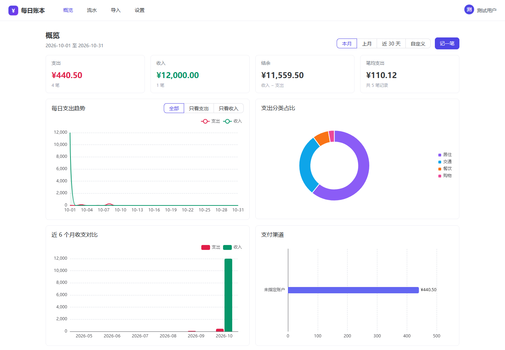
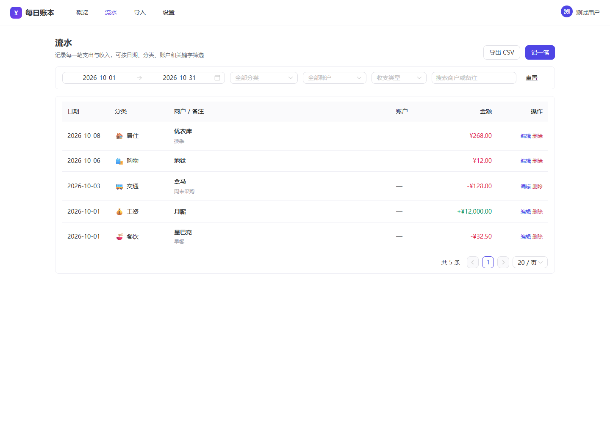
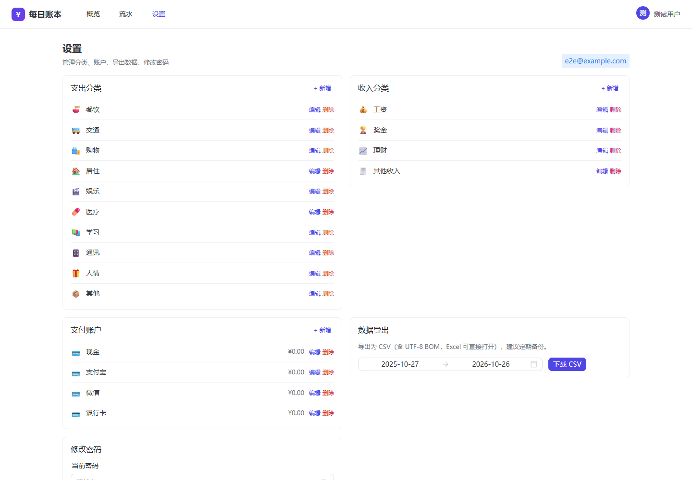
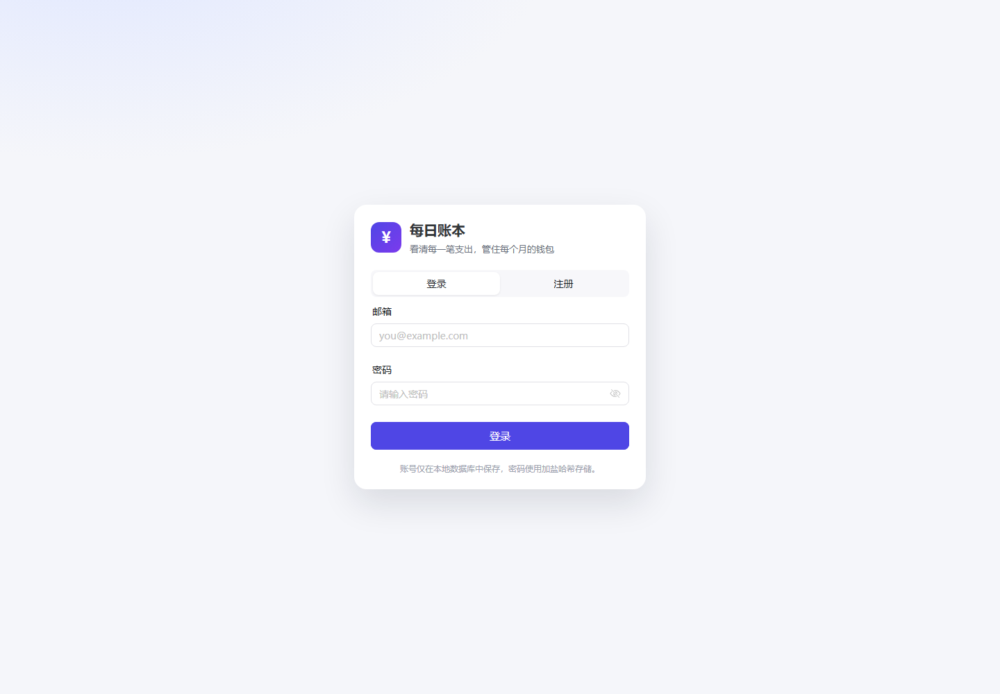

# 每日账本 · DailySpend

一个自用的个人记账网站：记录每天花了多少钱、花在哪，并用图表回答「这个月的钱去哪了」。
后端 Flask + SQLAlchemy，前端 Vue 3 + Vite + Naive UI + ECharts，数据库开发期用 SQLite，
后续可平滑迁移到 Oracle。

## 界面预览

| 概览 | 流水 |
| --- | --- |
|  |  |

| 设置 | 登录 |
| --- | --- |
|  |  |

（截图由 `scripts\e2e_smoke.py` 用无头浏览器真实渲染生成，示例数据仅供演示。）

## 功能

- **记账**：金额、日期、分类、账户、商户、备注；收支方向由分类类型自动判定
- **流水查询**：按日期区间 / 分类 / 账户 / 收支 / 来源 / 关键字筛选，四种排序 + 服务端分页
- **概览看板**：本期支出/收入/结余/笔均支出，每日趋势、支出分类占比、近 6 个月收支对比、支付渠道分布
- **账单导入**：导入微信支付 / 支付宝导出的 CSV 明细，先预览再落库，按交易单号自动去重
- **基础数据**：分类与账户的增删改（删除前会检查是否被流水引用）
- **数据导出**：CSV（带 UTF-8 BOM，Excel 直接打开），按日期区间导出备份
- **账号体系**：注册 / 登录 / 登出 / 改密，会话 Cookie + CSRF 防护，登录失败限流
- **多用户隔离**：所有数据按用户隔离，同一个实例可以给家人各开一个账号

## 技术选型与几个关键决定

| 决定 | 原因 |
| --- | --- |
| 金额存 `amount_cents`（整数分） | 避免浮点误差；SQLite 与 Oracle 的 DECIMAL 往返行为不同，整数最稳 |
| 所有聚合在日期列上分组 | 不用 `strftime`/`to_char` 这类方言函数，切 Oracle 时 SQL 不用改 |
| 前端构建产物由 Flask 托管 | 同源部署，Cookie 与 CSRF 天然可用，不需要 CORS |
| 先 SQLite 后 Oracle | 开发期零依赖；迁移路径靠 Alembic + 连接串切换保留 |
| 软删除流水 | 误删可救（数据库里仍有记录，仅 API 不可见） |

## 目录结构

```
backend/
  app/
    __init__.py        create_app 工厂
    config.py          pydantic-settings 配置（DS_* 环境变量）
    models.py          users / categories / accounts / transactions
    schemas.py         pydantic 请求校验
    errors.py          统一 JSON 错误
    web.py             托管前端 SPA
    api/               auth、categories、accounts、transactions、stats、exports
    services/          统计聚合、默认数据、登录限流
  migrations/          Alembic 迁移
  tests/               pytest（65+ 用例）
  wsgi.py              WSGI 入口
frontend/
  src/
    views/             LoginView / DashboardView / TransactionsView / SettingsView
    components/        TransactionDialog、BaseChart
    api/               axios 客户端（CSRF 自动续签）与接口封装
    stores/ router/    状态与路由
scripts/               dev.ps1 / bootstrap.ps1 / build-frontend.ps1 / serve.ps1
```

## 快速开始（Windows）

```powershell
# 1) 安装 Python 依赖到 .pylibs（无需 venv，适配受限环境）
scripts\bootstrap.ps1

# 2) 初始化数据库（SQLite 会自动落在 instance\ 目录）
scripts\dev.ps1 -m flask --app wsgi:app db upgrade

# 3) 启动后端（开发）
scripts\dev.ps1 -m flask --app wsgi:app run --port 5000

# 4) 另一个窗口：启动前端开发服务器
scripts\build-frontend.ps1 -Dev    # 等价于 cd frontend; npm run dev
```

打开 <http://127.0.0.1:5173> 注册账号即可开始记账（Vite 会把 `/api` 代理到 5000 端口）。

> 若本机没有 Node，可把官方 zip 解压到 `.tools\node`，脚本会自动优先使用它。

## 生产模式（单进程）

```powershell
scripts\build-frontend.ps1          # 产物输出到 frontend\dist
scripts\serve.ps1                   # waitress 监听 0.0.0.0:8000
```

Flask 直接托管 `frontend\dist`，访问 <http://127.0.0.1:8000> 即可，无需额外反向代理。
放到公网时请在前面加一层 HTTPS（Nginx/Caddy），并：

- `.env` 里设置 `DS_SECRET_KEY=<足够长的随机串>`
- `DS_SESSION_COOKIE_SECURE=true`（有 HTTPS 才开）
- `DS_REGISTRATION_ENABLED=false`（不再开放注册，账号用 `flask user create` 创建）

## 配置

复制 `.env.example` 为 `.env` 后按需修改，所有变量以 `DS_` 前缀：

| 变量 | 默认值 | 说明 |
| --- | --- | --- |
| `DS_SECRET_KEY` | 开发用固定值 | 会话与 CSRF 签名密钥，公网必须更换 |
| `DS_DATABASE_URL` | `sqlite:///instance/dailyspend.sqlite3` | 数据库连接串 |
| `DS_TIMEZONE` | `Asia/Shanghai` | 决定「今天」和审计时间 |
| `DS_SESSION_COOKIE_SECURE` | `false` | HTTPS 环境改为 `true` |
| `DS_SESSION_LIFETIME_DAYS` | `14` | 会话有效期 |
| `DS_REGISTRATION_ENABLED` | `true` | 是否开放注册 |
| `DS_PASSWORD_MIN_LENGTH` | `8` | 密码最小长度 |

## 迁移到 Oracle

代码已经按 Oracle 可用的方式写好，切换只需要建用户、改连接串、跑迁移三步。

### 1. 建应用用户（一次）

用 SYSTEM/SYS 连到 PDB 后执行 `scripts\setup-oracle.sql`（先改里面的口令）：

```powershell
sqlplus system@//localhost:1521/FREEPDB1 @scripts\setup-oracle.sql
```

本机实测环境（Oracle 23ai Free）：

| 项 | 值 |
| --- | --- |
| `ORACLE_HOME` | `D:\Database\oracle\dbhomeFree` |
| 监听 | `localhost:1521`（`FREE` 与 `FREEPDB1` 两个服务名都可用，应用建议用 PDB `FREEPDB1`） |
| 驱动 | `python-oracledb` **thin 模式**，不需要 Instant Client，也不需要设 `ORACLE_HOME` |

### 2. 改连接串

`.env` 里写（口令含特殊字符时要 URL 编码）：

```
DS_DATABASE_URL=oracle+oracledb://dailyspend:密码@localhost:1521/?service_name=FREEPDB1
```

### 3. 建表并验证

```powershell
scripts\dev.ps1 -m flask --app wsgi:app db upgrade   # 按迁移建表
scripts\dev.ps1 ..\scripts\oracle_check.py           # 只读体检：版本/用户/表/行数/迁移版本
```

### 已经处理掉的 Oracle 差异（都有测试守着）

- **主键**：用 `Identity(always=False)`，Oracle 渲染成 `GENERATED BY DEFAULT AS IDENTITY`，
  SQLite 直接忽略（其 `INTEGER PRIMARY KEY` 本身自增）——同一套模型两边都能插入
- **中文长度**：`String(n)` 在 Oracle 上自动渲染为 `VARCHAR2(n CHAR)`，按字符而不是字节
- **外键动作**：只用 `CASCADE` / `SET NULL`；Oracle 没有 `ON DELETE RESTRICT` 语法，
  不写子句即等价（模型里已去掉 RESTRICT）
- **空串**：Oracle 把 `''` 当 NULL，API 层统一把空的可选字符串归一化为 `None`，两边返回一致
- **CLOB**：启动时设置 `oracledb.defaults.fetch_lobs = False`，`note` 字段不会返回 LOB 句柄
- **连接池**：Oracle 自动加 `pool_recycle=1800`（避免 `ORA-02396`）与有界池；SQLite 不加
- **标识符**：表/列/索引/约束名都控制在 30 字符内（老版本 Oracle 的上限）
- **大小写**：SQLAlchemy 建出的是带引号的小写标识符，所以**原生 SQL 必须写 `"transactions"`**

其他：23ai Free 有 12GB 用户数据与 2GB 内存上限，个人记账远远够用。

## 测试

```powershell
scripts\dev.ps1 -m pytest -q                       # 后端全部用例
scripts\dev.ps1 -m pytest --cov=app --cov-report=term-missing
```

测试覆盖：认证与限流、CSRF、分类/账户/流水的 CRUD 与越权隔离、统计聚合、CSV 导出、账单导入（含去重与编码）、
SPA 回退、配置与工具函数。测试使用独立的临时 SQLite 文件，不会碰到开发库。

### 前端与端到端验证

```powershell
scripts\build-frontend.ps1                  # 内含 vue-tsc --noEmit 类型检查 + vite 打包
scripts\dev.ps1 ..\scripts\e2e_smoke.py     # 真实 HTTP + 无头浏览器冒烟
```

`e2e_smoke.py` 会建一个临时库、起真实服务（API + 已构建的 SPA），然后：

- 按浏览器的流程走一遍：取 CSRF → 登录 → 建/改/删流水 → 看板统计 → CSV 导出 → SPA history 回退
- 用无头 Edge/Chrome 真正渲染**登录页、概览、流水、导入、设置**五页并截图到 `.tmp\screenshots\`，
  任意一页白屏（打包或运行时错误）都会判定失败

> 前端目前没有单元测试，靠上面的类型检查 + 端到端冒烟兜底；后续接入 vitest 时从这里扩展。

## 账单导入（微信 / 支付宝）

入口：顶部导航「导入」。流程是**先预览、再确认**，预览不会写任何数据。

| 项目 | 说明 |
| --- | --- |
| 支持格式 | 微信支付账单明细 CSV、支付宝交易明细 CSV（`用于个人对账` 导出后解压得到的文件） |
| 编码 | 自动识别 UTF-8 / UTF-8 BOM / GBK（支付宝老版本是 GBK） |
| 前缀行 | 账单开头的账户信息、汇总、说明行会被自动跳过，按「交易时间 / 收/支 / 金额」定位表头 |
| 金额 | 去掉 `¥`、千分位逗号后按「分」入库 |
| 收支 | `支出` → 支出，`收入` → 收入；`其他`、`不计收支`、以及「退款/失败/关闭/撤销」状态的行会被跳过并给出原因 |
| 去重 | 用账单自带交易单号做 `(user_id, external_id)` 唯一键；没有单号的按「日期+金额+收支+对方」哈希，重复导入 0 新增 |
| 分类 | 支付宝用「交易分类」按关键词映射到你的分类；微信没有分类信息，用你选的默认分类（同类型才生效），最后兜底到「其他」 |
| 账户 | 按「支付方式 / 收付款方式」匹配账户名，匹配不到再按类型猜（零钱→微信、花呗→信用卡、银行→银行卡），最后用默认账户 |

导入的流水带 `source` 标记（微信 / 支付宝），列表里会显示小标签，也可以用 `?source=wechat` 过滤，导出 CSV 同样能看到。

自测用的样例账单在 `backend\tests\fixtures\` 下，可直接拿来试。

## 数据备份

- 应用内「设置 → 数据导出」按区间导出 CSV
- SQLite：直接复制 `instance\dailyspend.sqlite3`（建议先停服务）
- Oracle：`expdp dailyspend/密码@FREEPDB1 tables=... directory=... dumpfile=...`

## 已知限制 / 后续可以做的

- 目前没有「预算与超支提醒」「标签」「多币种」
- 账单导入只覆盖微信/支付宝的 CSV 明细，不含银行流水；退款是「跳过整行」而不是冲抵原交易
- 流水删除是软删除，但还没有回收站界面
- 单进程限流（内存计数），多 worker 部署时需要换成 Redis
- 没有附件（发票照片）上传
- 前端没有单元测试（依赖类型检查与端到端冒烟），也没有移动端专门适配（目前靠响应式栅格）

## 开发约定

- 每次改动都要跑通测试并提交一个 Git commit（见 `AGENTS.md`）
- PowerShell 脚本保持 ASCII，避免 Windows PowerShell 5.1 按 ANSI 解析出现语法错误
